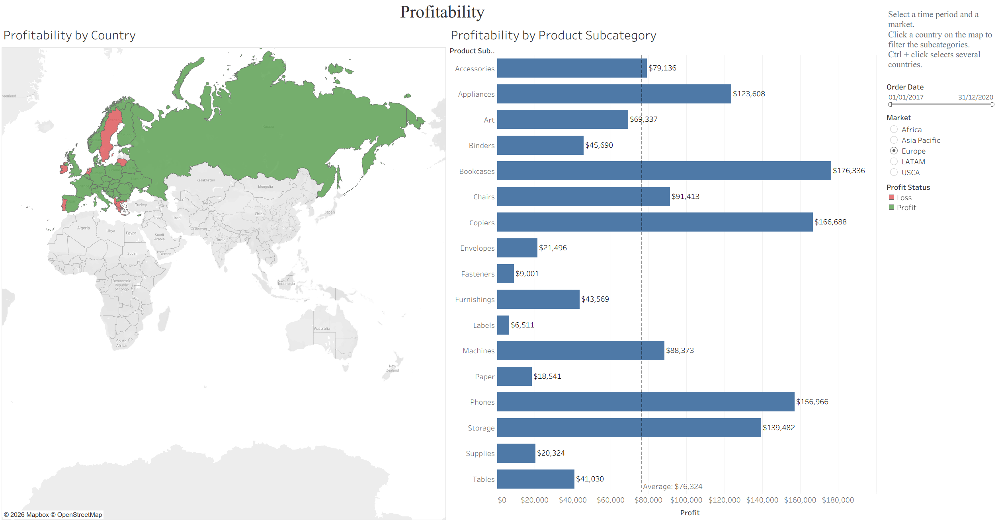
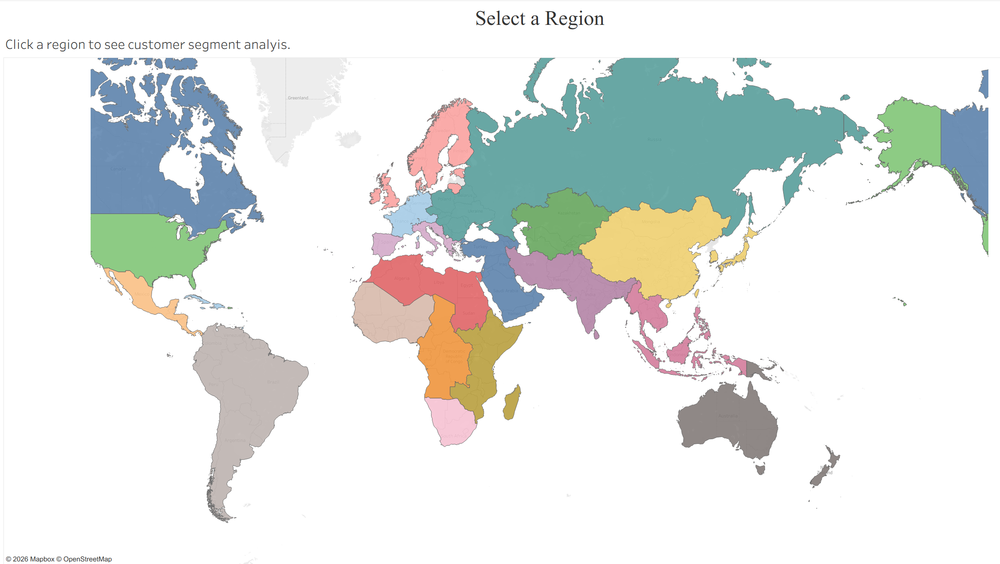
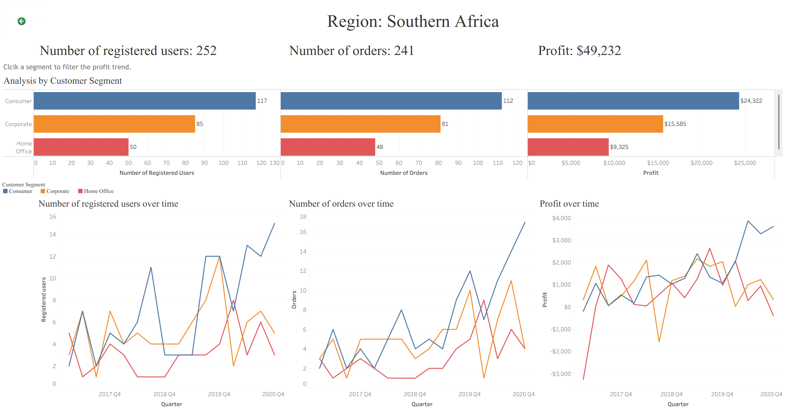

# Superstore Profitability and Customer Analysis

I built this Tableau project to explore sales and customer activity for Superstore, a global online retailer of office equipment. The dashboards show where the store makes or loses money, which product subcategories contribute the most profit, and how registrations, orders, and profit vary across customer segments from 2017 to 2020.

## Dashboards

### Profitability

The country map shows whether total profit is positive or not, and the bar chart ranks product subcategories by total profit in USD. The dashed line shows the average of the subcategory profit totals in the filtered view. Choose an order date range and one market, then click a country on the map to filter the bars.



### Select a Region

Click a region on the world map to open **Customer Segment Overview** filtered to that region. Use the back arrow on the overview to return to the map.



### Customer Segment Overview

The overview shows totals, segment comparisons, and quarterly trends for registered users, orders, and profit. Registrations are grouped by registration date; orders and profit are grouped by order date. The title shows the selected region, or **All regions** when no region filter is applied.

Click a Consumer, Corporate, or Home Office bar to filter **only the profit trend**. Clear the selection to restore all three lines.



## Example findings

- **Europe:** From 2017 to 2020, Bookcases had the highest total profit of any subcategory at **$176,336**, compared with an average of **$76,324** across the subcategories shown.
- **Southern Africa:** The overview shows **252 registered users**, **241 orders**, and **$49,232** in total profit. Consumer was the largest segment by all three measures and contributed **$24,322** in profit, just under half the regional total.

## Data and calculations

The source is `SUPERSTORE.xlsx`, an Excel dataset provided for a Tableau assignment. I connected its four sheets using Tableau relationships. The `PURCHASE` table is at the order-line level, so an order can have multiple purchase rows, and customers can register without placing an order.

| Relationship | Key | Cardinality |
| --- | --- | --- |
| `CUSTOMER` → `ORDER` | `CustomerID` | One-to-many |
| `ORDER` → `PURCHASE` | `OrderID` | One-to-many |
| `PURCHASE` → `PRODUCT` | `ProductID` | Many-to-one |

I calculated invoice amount and profit for each purchase line, then summed profit for the views. The invoice amount applies the discount to the sale price, while the cost is the unit cost multiplied by quantity.

```text
Invoice Amount = [Unit Price] * [Quantity] * (1 - [Discount])
Profit = [Invoice Amount] - ([Quantity] * [Expenses Unit Cost])
```

## Open the workbook

Download [Superstore Profitability and Customer Analysis.twbx](Superstore-Profitability-and-Customer-Analysis.twbx) and open it in Tableau Desktop. The [packaged workbook](https://help.tableau.com/current/pro/desktop/en-us/save_savework_packagedworkbooks.htm) includes the data needed to explore the dashboards, so there is no separate Excel file to download.
